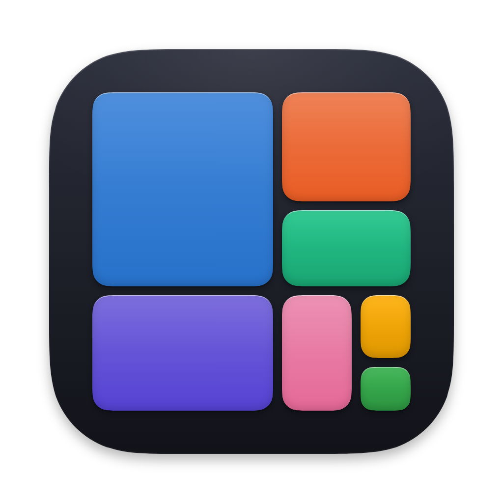
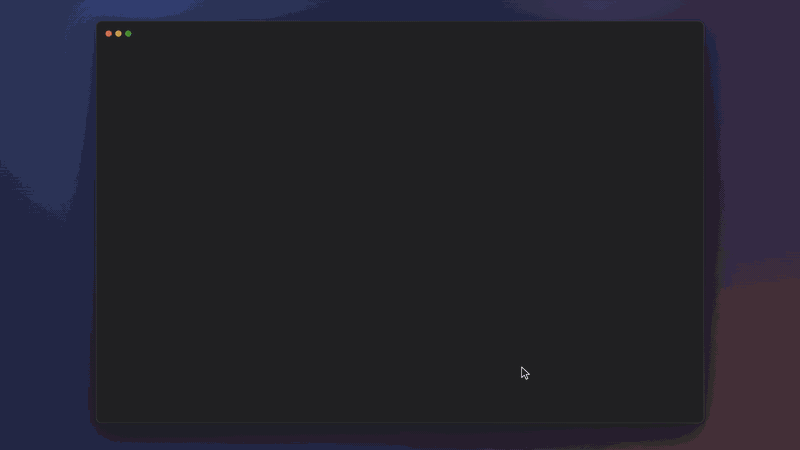
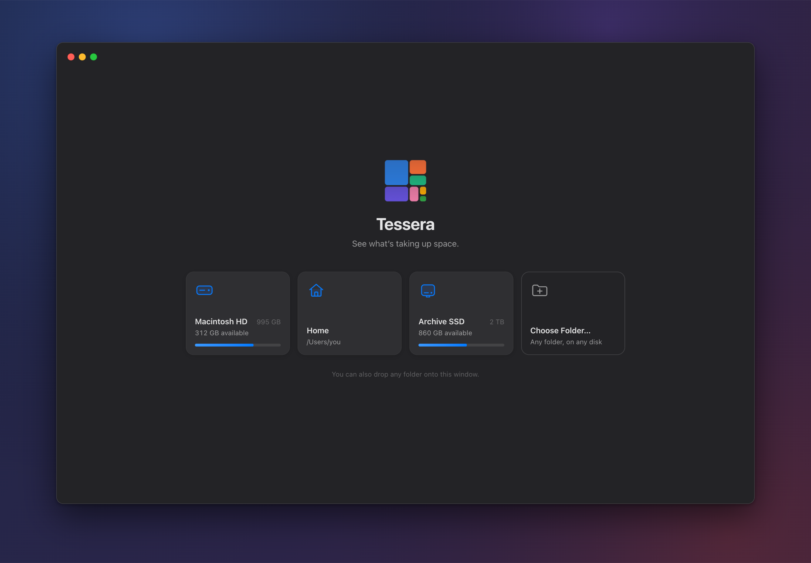
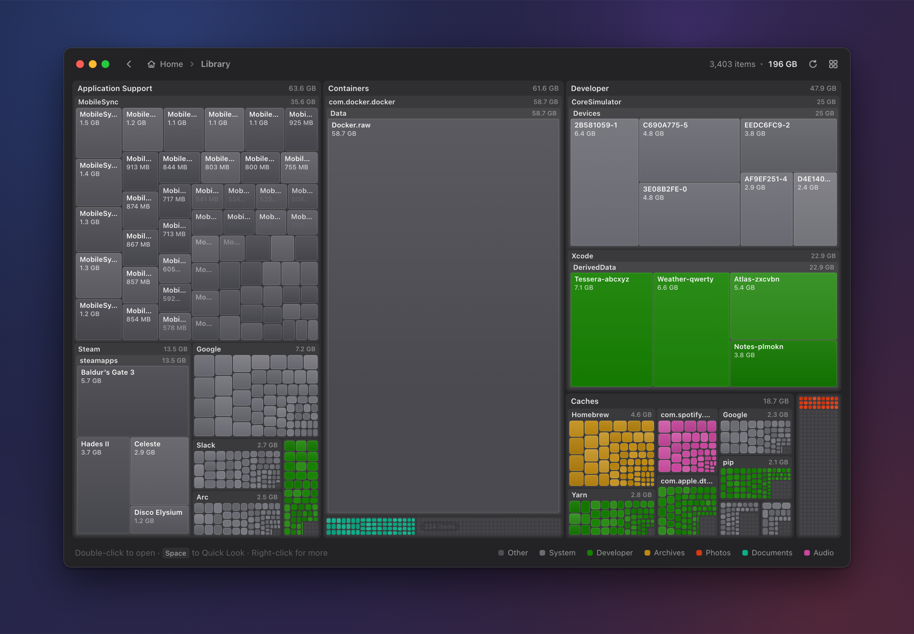
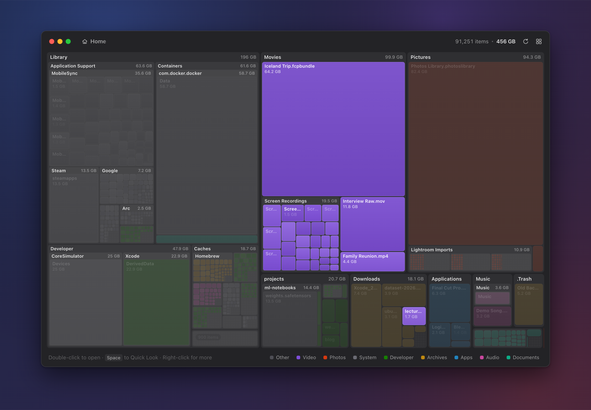
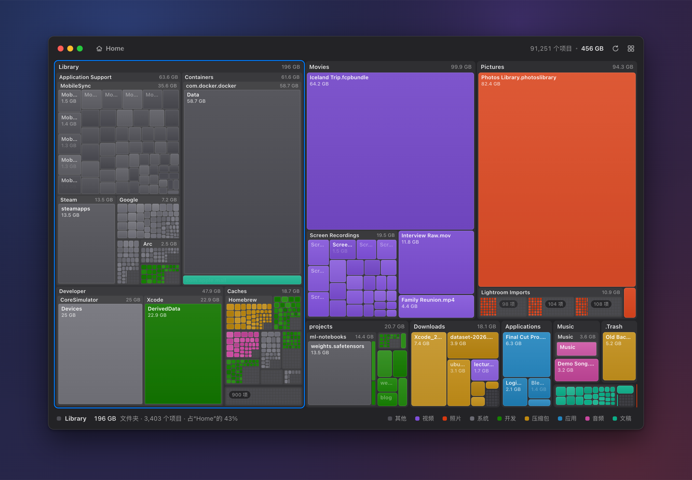

<p align="center">
  
</p>

<h1 align="center">Tessera</h1>

<p align="center"><b>See what’s taking up space.</b><br>
A disk-space visualizer for macOS that draws your whole disk as one living, zoomable treemap.</p>

<p align="center">
  
  
  
  
</p>

<p align="center">
  
</p>

<p align="center"><sub>Demo data. <a href="docs/media/tessera-demo.mp4">Watch it as an MP4 (1080p)</a>.</sub></p>

Tessera takes the best idea in [SpaceSniffer](http://www.uderzo.it/main_products/space_sniffer/)
(a nested treemap that makes file size *physical*) and rebuilds it for the Mac, keeping only what
serves that idea. You pick a disk or a folder and the map assembles **while the scan is still
running**. Big things are big, so you can see at a glance what's eating your disk, dive in with a
double-click, and move the culprit to the Trash.

## Highlights

- **A live map, not a progress bar.** The scan runs breadth first in its own process, so the picture fills in evenly from the first second. It scanned a folder of about 470,000 files in under 5 seconds on an M-series Mac.
- **Motion that explains.** Every tile is driven by critically damped springs. Zooming is a single camera move: the folder you open grows to fill the window, its siblings fly out of frame, and its contents resolve in place.
- **Color means kind.** Apps, Video, Photos, Audio, Documents, Archives, Developer, System and Other each get a color. The palette was validated so that every pair stays distinct, including for color-blind viewers. Hover a legend chip to isolate one kind.
- **Native where it counts.** Tessera uses a hidden title bar with vibrancy, so the toolbar has no divider line. The menus, context menus, confirmation sheets, Quick Look and Reveal in Finder are all the real macOS ones.
- **Safe by design.** Tessera only moves items to the Trash, always after a confirmation sheet, so anything can be put back. It never deletes permanently.
- **Private.** Everything happens locally. The app makes no network requests at all, and its content security policy blocks them.
- **English and 简体中文.** Switch under View → Language, and the change applies live.

<table>
  <tr>
    <td></td>
    <td></td>
  </tr>
  <tr>
    <td></td>
    <td></td>
  </tr>
</table>

## Features

- **Live treemap while scanning.** The map assembles as the scan walks the disk, breadth first, so it fills in evenly.
- **Zoom with spring animations.** Double-click a folder (or pinch, or press ⌘↓) to dive in. Go back up with the chevron, the breadcrumbs or ⌘↑.
- **Kinds legend with highlight.** Hover a legend chip to dim every other kind and show its total, and click it to lock the highlight.
- **Quick Look** (Space) for whatever is selected or under the pointer.
- **Reveal in Finder**, **Open** and **Copy Path** from the native context menu.
- **Move to Trash** (⌘⌫ or the context menu). It always shows a confirmation sheet first, and you can put the item back from the Trash.
- **Drag and drop.** Drop a folder anywhere on the window, or on the Dock icon in the packaged app, to scan it.
- **Locations.** The welcome screen lists Macintosh HD with its free space, Home, any external drives (mounted `.dmg` installers are hidden) and **Choose Folder…**.

Deliberately left out: filter syntax, tags, exports, a settings window, permanent delete and a
list view. [docs/DESIGN.md](docs/DESIGN.md) explains why.

## Install

There's no prebuilt download yet, so build it yourself. It takes about a minute:

```sh
git clone https://github.com/MockingFinch/tessera.git
cd tessera
nvm use              # Node 24, from .nvmrc (any Node ≥ 22.12 works)
npm install          # also downloads the Electron binary
npm run package      # → dist/Tessera-darwin-arm64/Tessera.app
open dist/Tessera-darwin-arm64
```

Drag `Tessera.app` into Applications. To see everything on your disk, give it **Full Disk
Access** (see [below](#full-disk-access)). Without it, macOS hides some folders, and Tessera
shows a *Limited access* pill.

To just run it from source, use `npm start`.

## Requirements

- **macOS 13 or later.** The packaged app sets `LSMinimumSystemVersion` 13.0 and is built for Apple silicon (arm64) only.
- **Node 22.12 or later** for tooling. `electron@44.9.0`, `@electron/get` and `@electron/packager` all declare `"node": ">= 22.12.0"`, and Electron's install script downloads the binary through `@electron/get`. The repo's `.nvmrc` pins Node 24.

## Development

```sh
nvm use          # Node 24, from .nvmrc
npm install      # also downloads the Electron 44.9.0 binary
npm start        # electron .
```

Tessera is plain JavaScript on Electron 44: CommonJS in the main, preload and scanner code, and ES
modules in the renderer. There's no bundler, no framework and no runtime npm dependency.

`npm run dev` does the same as `npm start` and also opens a detached DevTools window. This only
works when the app isn't packaged.

## Scripts

| Command | What it does |
|---|---|
| `npm start` | Runs the app from source (`electron .`). |
| `npm run dev` | Same as `npm start`, plus detached DevTools. |
| `npm run icon` | Runs `scripts/make-icon.js` under Electron. It renders the icon offscreen and writes `build/icon.png` (1024 px), `build/icon.iconset/` (via `sips`), `build/icon.icns` (via `iconutil`) and `build/mark.svg`. |
| `npm run package` | Runs `scripts/package.js`, which builds `dist/Tessera-darwin-arm64/Tessera.app` with `@electron/packager` (asar, arm64), then checks the signature and re-signs ad hoc if needed. It uses the committed `build/icon.icns`, so you only need `npm run icon` if you change the icon. |
| `node scripts/scan-bench.js <path>` | Scanner benchmark in plain Node. See [Scanner bench and fixture test](#scanner-bench-and-fixture-test). |
| `node scripts/scan-fixture-test.js` | Scanner correctness checks against a generated fixture tree. |

## Controls

Keys without a modifier are handled by the renderer and only work on the map screen. Shortcuts
with ⌘ or ⌥ are menu accelerators, so they also appear in the menus.

### Mouse and trackpad

| Input | Action |
|---|---|
| Click | Select a tile. Clicking empty space clears the selection. |
| Double-click | Folder: zoom in. File or package: Quick Look. "Smaller items": zoom into the folder that holds it. |
| Right-click | Context menu: Open in Tessera (folders) or Open (files, packages), Quick Look, Reveal in Finder, Copy Path, Move to Trash…. "Smaller items" has no menu. |
| Hover | The readout under the map shows the name, size, kind or item count, and share of the current folder. |
| Pinch open (spread) | Zoom into the folder under the pointer, one level below the current one. |
| Pinch closed | Enclosing folder. |
| Breadcrumb or back chevron | Go to that ancestor folder. The folder you came from is selected when you arrive. |
| Legend chip | Hover to highlight that kind and show its total in the readout. Click to lock or unlock the highlight. |

### Keyboard

| Key | Action |
|---|---|
| Space | Quick Look the selected tile, or the hovered one if nothing is selected. |
| Esc | Clear the selection. If nothing is selected, go to the enclosing folder. |
| Return | Open the selection: zoom into a folder, or Quick Look a file or package. |
| Backspace | Enclosing folder. |
| ← → ↑ ↓ | Move the selection to the nearest sibling tile in that direction. With nothing selected, the first press selects the largest top-level tile. |
| ⌘↑ | Enclosing Folder (View menu). |
| ⌘↓ | Open Selection (View menu). |
| ⌘Y | Quick Look (View menu). |
| ⌥⌘C | Copy Path of the selection (Edit menu). |
| ⌘⌫ | Move the selection to the Trash, after a confirmation sheet (Edit menu). |
| ⌘O | Scan Folder…, which opens a folder picker (File menu). |
| ⇧⌘H | Scan Home Folder (File menu). |
| ⌘R | Rescan the current location (File menu). |
| ⇧⌘L | Back to Locations. This also stops the scan and frees its memory (View menu). |
| ⌘W | Close Window. Closing the window quits Tessera. |
| ⌥⌘I, ⇧⌘R | Toggle Developer Tools and Reload Window. These are in View → Developer and only exist when the app isn't packaged. |

## Full Disk Access

macOS privacy protection (TCC) blocks apps from parts of your home folder (Mail, Messages,
Safari, other apps' containers) and from parts of the system. Without **Full Disk Access**,
Tessera can't read those folders. The scanner counts each unreadable entry as an error and skips
it, so the map comes out smaller than the disk really is.

When a scan of **Macintosh HD** or **Home** finishes with any errors, a **Limited access** pill
appears in the toolbar. Clicking it opens System Settings → Privacy & Security → Full Disk Access.
Turn Tessera on there, then rescan with ⌘R. Without Full Disk Access, macOS may also ask for
permission the first time a scan reaches Desktop, Documents, Downloads or a removable volume.

Two practical notes:

- When you run from source with `npm start`, macOS attributes file access to the app that launched the process (your terminal). To test with full access, either grant Full Disk Access to the terminal or use the packaged app.
- The pill counts every error, including files deleted while the scan was running, so it can still appear after you've granted access.

## Dev hooks

Main reads these environment variables at startup. A sandboxed preload can't read `process.env`,
so main passes the renderer-side values in a `--tessera-dev=<json>` argument, and the preload
exposes them as `tessera.dev`.

| Variable | Effect |
|---|---|
| `TESSERA_AUTOSCAN=/path` | The renderer starts scanning that path as soon as it loads. |
| `TESSERA_SHOT_DIR=/dir` | Enables `tessera.dev.capture(name)`, which saves `webContents.capturePage()` as `<dir>/<name>.png`. It also runs the screenshot tour in `src/renderer/js/devtour.js`, turns off background throttling so the tour keeps animating behind other windows, and forwards renderer warnings, errors and `[tour]` lines to stdout. |
| `TESSERA_SELFTEST=/path` | Skips the UI entirely: no window, no Dock icon. Scans the path, prints a JSON summary to stdout (totals, per-kind bytes and the root's top 10 children), then exits with code 0. It exits with 1 on failure and 2 after a 15-minute timeout. Logs go to stderr. |
| `TESSERA_DEMO=1` | The renderer uses the built-in demo home folder from `js/mock.js` instead of real scans, while keeping the real window, menus and language. The tour then scans the demo. This is how the screenshots in `docs/media` are made, so they show no one's real files. |
| `TESSERA_RECORD_DIR=/dir` | Records every painted frame as a JPEG (1600 px wide) plus a `frames.json` of timestamps, and plays a paced "film" take with a drawn pointer instead of the screenshot tour. `docs/media/tessera-demo.mp4` and the GIF were made from this with ffmpeg. |
| `TESSERA_WORKER=/path/to/worker.js` | Forks this file as the scanner instead of `src/scanner/worker.js`. If the file doesn't exist, `scan:start` fails with `scanner-missing`. |

Examples:

```sh
# Screenshot tour of a folder
TESSERA_SHOT_DIR="$PWD/shots" TESSERA_AUTOSCAN="$HOME/projects" npx electron .

# Headless scan. Use npx rather than npm start, because npm prints its own header to stdout.
TESSERA_SELFTEST="$HOME/Downloads" npx electron . | jq .top
```

The tour captures `01-welcome` through `16-en-welcome`, with a `07b-selected-corner` shot in
between. Without `TESSERA_AUTOSCAN`, it only captures the welcome screen. It switches the language
to 简体中文 and back, and that choice is persisted, so `settings.json` ends up set to English.

From DevTools, `window.__tessera` gives you the renderer's `state`, the `treemap` instance and the
navigation helpers (`zoomTo`, `goUp`, `startScan`, `fetchView`, `showWelcome`, `setLang`).

## Previewing the renderer in a browser

The renderer runs in a plain browser as well. When `window.tessera` is missing, `app.js` loads
`js/mock.js`, a stand-in API that fabricates a home folder and "scans" it over about 7 seconds. It
speaks the same view protocol as the real scanner. ES modules don't load from `file://`, so serve
the folder over HTTP:

```sh
cd src/renderer
python3 -m http.server 5417 --bind 127.0.0.1
open "http://127.0.0.1:5417/?scan=/Users/you"
```

`?scan=` starts a mock scan on load. The mock always builds the same tree, and only the root's name
comes from the path. Without `?scan=` you get the welcome screen with mock locations. In the mock:

- the context menu is a `prompt()`;
- Move to Trash is a `confirm()`;
- the language is kept in `localStorage`;
- `tessera.emitCommand({ cmd: 'go-up' })` stands in for a menu command (`cmd` takes the same values as main's `app:command`).

## Scanner bench and fixture test

Both scripts load `src/scanner/core.js` directly in plain Node. Neither needs Electron.

```sh
node scripts/scan-bench.js ~/Library [--json] [--no-du] [--du-timeout=<sec>] \
     [--exclude=<abs path>]… [--concurrency=<n>] [--lanes=<n>]
```

The bench scans the path and reports:

- files, directories, bytes, errors and elapsed time;
- memory, CPU and main-thread utilization;
- the latency of one view taken mid-scan;
- the median of 20 views of the root and of its largest child (depth 3);
- the top 10 children;
- a comparison against `du -sk`, unless you pass `--no-du`.

Progress goes to stderr, and the report (or JSON with `--json`) goes to stdout.

```sh
node scripts/scan-fixture-test.js [--keep]
```

The fixture test builds a small tree under `$TMPDIR/tessera-fixture` and checks the scanner against an independent reference walk and `du`. It covers:

- kind classification, packages as leaves and forced kinds;
- hard-link de-duplication, symlinks, exclusions and unreadable folders;
- aggregates and their dominant kind, and view depth;
- `remove()` bookkeeping, including a removal in the middle of a scan.

It exits with code 0 when every check passes. `--keep` leaves the fixture on disk.

## Project layout

```
tessera/
├── package.json            scripts; devDependencies electron 44.9.0, @electron/packager 20.3.0
├── .nvmrc                  Node 24 for tooling
├── docs/
│   ├── SPEC.md             engineering contract: protocol, keys, view format, API
│   ├── ARCHITECTURE.md     how the pieces fit together
│   ├── DESIGN.md           product and design decisions (color, motion, appearance, cuts)
│   └── media/              screenshots, demo GIF and MP4 (made with TESSERA_DEMO + TESSERA_RECORD_DIR)
├── build/                  icon.png, icon.icns, icon.iconset/, mark.svg (npm run icon)
├── dist/                   Tessera-darwin-arm64/Tessera.app (npm run package)
├── scripts/
│   ├── make-icon.js        renders the app icon (runs under Electron)
│   ├── package.js          packages and ad-hoc signs the app
│   ├── scan-bench.js       scanner benchmark (plain Node)
│   └── scan-fixture-test.js  scanner correctness checks (plain Node)
└── src/
    ├── main/
    │   ├── main.js         lifecycle, window, IPC, scanner process manager, trash flow, settings
    │   ├── menu.js         application menu and tile context menu
    │   ├── locations.js    volume and home discovery, scan exclusions
    │   └── i18n.js         main-process strings (en, zh)
    ├── preload/
    │   └── preload.js      contextBridge → window.tessera
    ├── scanner/
    │   ├── worker.js       utilityProcess entry: wires core.js to parentPort
    │   ├── core.js         traversal, tree, view/path/remove queries (no Electron imports)
    │   └── kinds.js        file-kind classification
    └── renderer/
        ├── index.html      page shell and CSP
        ├── styles.css      chrome styles (dark tokens)
        └── js/
            ├── app.js      screens, scan polling, navigation, chrome, keys, drag and drop
            ├── treemap.js  canvas treemap engine: layout, springs, drawing, hit testing
            ├── squarify.js squarified layout
            ├── kinds.js    kind labels and palette
            ├── format.js   byte, count and percent formatting
            ├── i18n.js     renderer strings (en, zh)
            ├── welcome.js  welcome screen, logomark, location cards
            ├── mock.js     fake window.tessera for browser preview
            └── devtour.js  screenshot tour (TESSERA_SHOT_DIR)
```

## Documentation

- [`docs/SPEC.md`](docs/SPEC.md) is the contract: the scanner protocol, keys, the view format, the preload API, IPC channels, size semantics and the string tables.
- [`docs/ARCHITECTURE.md`](docs/ARCHITECTURE.md) explains how the processes, the scanner, the view query and the treemap engine work, and lists the known limitations.
- [`docs/DESIGN.md`](docs/DESIGN.md) records the product and design decisions: what ships and what was cut, color (the validated kind palette), motion, appearance and language.

## License

[MIT](LICENSE) © MockingFinch
